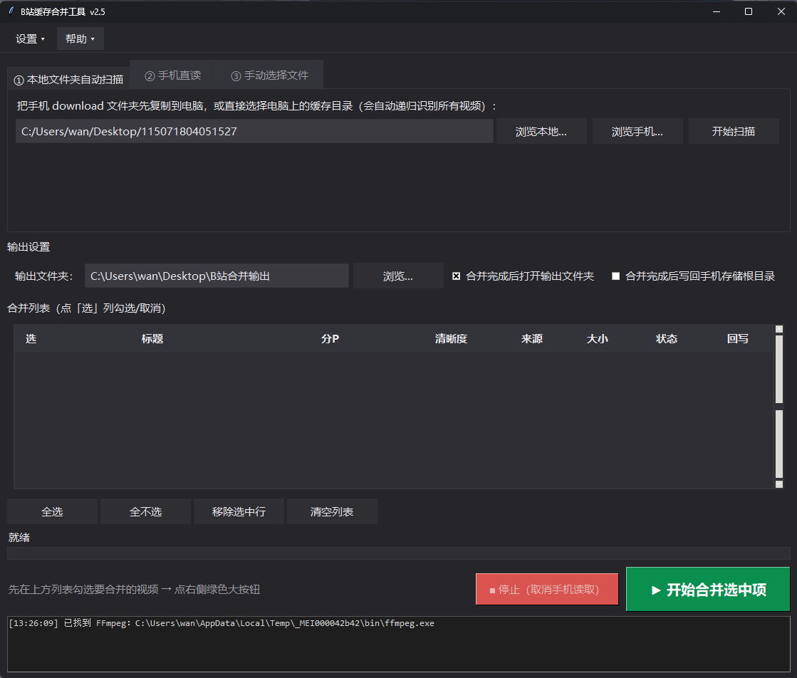

# B站缓存合并工具

> 还在烦恼 B站缓存的视频只能在 App 里看？稀有资源怕下架想备份却导不出来？想要 4K/HDR 画质却找不到下载方式？
>
> 这个工具把手机客户端缓存的分离式视频流一键合成完整 MP4，画质音质与缓存时完全一致，不重编码、速度接近复制文件。



把 B站安卓客户端缓存的分离式 `.m4s`（纯视频 + 纯音频）自动合并为完整 MP4，音画同步，不重编码，速度接近文件复制。

## 功能

- **本地文件夹扫描**：把手机里的 `download` 文件夹复制到电脑，自动递归识别所有缓存视频，自动挑最高清晰度
- **手机 MTP 直读（按需复制）**：手机解锁 + USB 文件传输模式，一键读取；扫描时只拉取 entry.json 元数据（标题/分P/大小，几 KB），不复制视频；勾选后仅复制并合并你选中的视频，省时省磁盘；临时文件关闭软件时自动清理
- **批量合并**：勾选多个视频一键合并，多 P 自动命名
- **写回手机**：合并完成后可选把 MP4 推送回手机 `Download` 目录，列表实时显示每个文件的回写结果
- **手动模式**：单独选 `video.m4s` 和 `audio.m4s` 合并
- **可取消**：读取/复制过程中随时点"停止"，不会卡死

## 下载

去 [Releases](../../releases) 下载 `B站缓存合并工具.exe`，双击即用，无需安装 Python 或 FFmpeg。

## 从源码运行

```bash
# 需要 Python 3.8+
pip install pyinstaller
# 把 ffmpeg.exe 放到 bin/ 目录
python B站缓存合并工具.pyw
```

## 打包成单文件 exe

```bash
pyinstaller --noconfirm --clean B站缓存合并工具.spec
# 产物在 dist/B站缓存合并工具.exe
```

## 使用说明

1. **本地扫描（最稳）**：手机数据线连电脑 → 把 `内部存储/Android/data/tv.danmaku.bili/download` 复制到电脑 → 软件选这个文件夹 → 开始扫描
2. **手机直读**：手机解锁、USB 选"文件传输/MTP" → 软件自动识别设备 → 点"一键读取手机 B 站缓存"（只读清单，很快）→ 勾选要合并的视频 → 开始合并，仅复制选中项
3. **新增几个视频时**：直接重新扫描即可，未选中的旧视频不会被复制，不用整批重拷
4. **安卓 11+ 限制**：若 MTP 无法访问 `Android/data`，在手机文件管理里把 `download` 复制到 `Download/bili`，再用"选择手机上的其他文件夹"选中

## 目录结构

```
B站缓存合并工具.pyw   # 主程序（GUI + 合并逻辑）
mtp_helper.ps1        # 手机 MTP 访问脚本（PowerShell）
bin/ffmpeg.exe        # 合并引擎（GPL，不进 git，Release 分发）
使用说明.txt
```

## 更新日志

- **v2.1**：修复单选/勾选一直不生效的根本问题——点击处理中误把 Treeview 的 `identify_region/column/row` 写成主窗口方法，已改为 `self.tree.identify_*`；现在点最左侧“选”列方块可正常勾选/取消
- **v2.0**：勾选交互定为「只有点击最左侧“选”列方块才切换」，点行其他位置不改变勾选，避免误触（当时因上述 bug 未生效，已在 v2.1 修复）
- **v1.7**：手机扫描改为增量显示——PowerShell 每解析一个 entry.json 即流式追加，Python 端边读边把视频逐个加入列表，顶部同步显示「已读取 N 个」，无需等全部扫描完成
- **v1.6**：手机直读改为「只读元数据 + 按需复制」——扫描阶段只拉取 entry.json（标题/分P/大小），不再整批复制全部缓存；勾选后仅复制选中视频，新增视频时无需重拷全部；临时文件统一在关闭软件时清理
- **v1.5**：修复 ttk 自定义按钮在 Windows 原生主题下空白（改用原生 tk.Button）；新增写回手机结果列；关于信息与版权声明；抑制 MTP 掉线系统弹窗
- **v1.4**：手机直读改为整批复制到本地镜像再识别，新增「停止」按钮防止 MTP 卡死；镜像复用、关闭时清理
- **v1.3**：自动枚举 MTP 设备（不再写死机型）；修复多视频列表去重导致只显示 1 个的问题
- **v1.0**：首版，本地文件夹扫描、手动模式、批量合并（FFmpeg 流复制）

## 版权

MIT License，Copyright (c) 2026 wan

- 作者：wan
- B站：https://space.bilibili.com/500886854

本工具仅供个人备份自己缓存的内容使用，请勿用于商业用途或二次分发。使用本工具造成的任何版权问题，由使用者自行承担。
